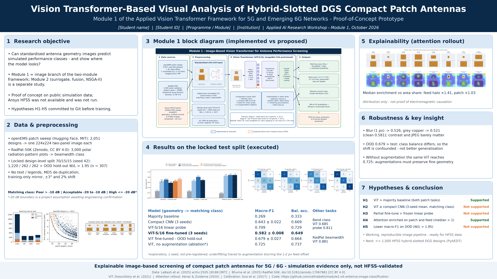
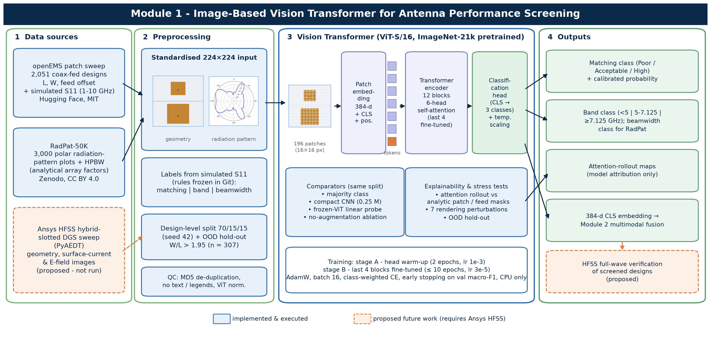
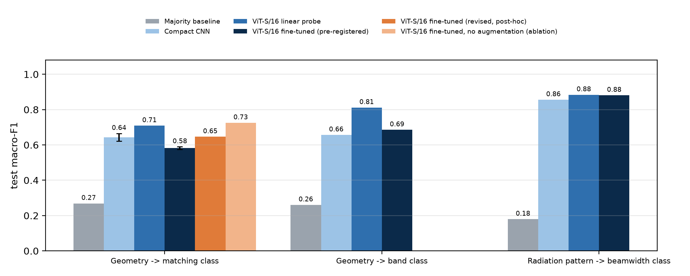
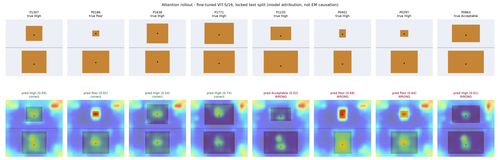

# Module 1 - Vision Transformer-Based Visual Analysis of Hybrid-Slotted DGS Compact Patch Antennas

*Image-based Vision Transformer for antenna-performance classification and explainable visual analysis (5G / emerging 6G) - a reproducible proof-of-concept prototype*

> **Status in one line:** the image module was implemented and **executed end-to-end on CPU** on two verified public simulation datasets:
> a ViT-S/16 classifier with three baselines, statistical comparison, attention-rollout explainability and robustness tests.
> **Ansys HFSS was not available and was not run.** No public HFSS image dataset of hybrid-slotted DGS antennas exists, so that dataset
> remains future work (see [docs/LIMITATIONS.md](docs/LIMITATIONS.md)).
>
> Module 2 (numerical-text surrogate, multimodal fusion and NSGA-II optimisation) is a separate repository:
> `https://github.com/rathiabeth/module2-numerical-surrogate-antenna-design`.



## Research objective

Investigate whether **standardised antenna geometry and electromagnetic images** can support **antenna-performance classification and
explainable visual analysis**, following the framework figure and the Module 1 ViT report. The research questions and hypotheses
H1–H5 are in [docs/HYPOTHESES.md](docs/HYPOTHESES.md); they were committed to Git before training.

## Block diagram



| Component | Implementation | Status |
|---|---|---|
| Standardised images | 224×224 two-panel geometry drawing per design (absolute scale + zoomed), no text; RadPat polar plots | executed |
| ViT-S/16 | `timm` ViT-S/16 (ImageNet-21k), head warm-up, then last 4 blocks fine-tuned; temperature scaling | executed |
| Baselines | majority class, compact CNN (0.25 M params), frozen-ViT linear probe, no-augmentation ablation | executed |
| Explainability & robustness | attention rollout scored against analytic patch / feed masks; 7 perturbations; OOD hold-out | executed |
| Embedding export | 384-d CLS embedding per design, used by Module 2 for fusion | executed |
| HFSS geometry / surface-current / E-field images | — | proposed |

## Verified datasets

| Dataset | Source | Licence | Used for |
|---|---|---|---|
| Rectangular Patch Antenna Frequency Response (2,051 openEMS designs) | [Hugging Face](https://huggingface.co/datasets/becklabash/rectangular-patch-antenna-freq-response), rev `4be72a2`; LaBash et al., arXiv:2505.18188 | MIT | geometry images, matching and band labels |
| RadPat-50K (3,000 of the 10K polar plots) | [Zenodo 10.5281/zenodo.17067881](https://doi.org/10.5281/zenodo.17067881) v1.1 | CC BY 4.0 | radiation-pattern image modality |

The candidate survey (11 sources, rejection reasons, discrepancies found) is in [docs/DATASET_SURVEY.md](docs/DATASET_SURVEY.md).
Label rules, the image standard and the QC record are in [docs/DATA_CARD.md](docs/DATA_CARD.md).

## Installation

```bash
git clone https://github.com/rathiabeth/module1-vit-antenna-image-classification.git
cd module1-vit-antenna-image-classification
python -m venv .venv
source .venv/bin/activate            # Windows: .venv\Scripts\activate
pip install -r requirements.txt --extra-index-url https://download.pytorch.org/whl/cpu
```

## Reproduce

```bash
python -m src.download_data          # pinned revisions + SHA-256 checks (~510 MB; --skip-radpat for ~10 MB)
python -m src.preprocessing          # labels, standardised images, locked splits, data dictionary
pytest -q                            # 18 preprocessing / integrity tests
bash scripts/run_experiments.sh      # Windows: powershell -File scripts\run_experiments.ps1  (~4 h on a 4-core CPU)
python scripts/make_deliverables.py  # block diagram, poster, slides, Word + LaTeX report from the executed metrics
```

Individual stages: `python -m src.train_vit --dataset patch --task perf_class --mode finetune --seed 42`,
`python -m src.train_baseline --model cnn`, `python -m src.explainability`, `python -m src.evaluate`.
See [docs/REPRODUCIBILITY.md](docs/REPRODUCIBILITY.md).

## Results (executed; locked test split)

All numbers come from `results/metrics/` and were produced on CPU (Intel i7-10610U). Nothing here is estimated or illustrative.

**Main task: geometry image → matching class** (Poor S11min > −10 dB | Acceptable −20 to −10 dB | High ≤ −20 dB; n = 262 test designs)

| Model | Seeds | Macro-F1 | Balanced acc. |
|---|---|---|---|
| Majority baseline | 1 | 0.269 | 0.333 |
| Compact CNN | 3 | 0.643 ± 0.022 | 0.669 |
| ViT-S/16 frozen linear probe | 1 | 0.709 | 0.729 |
| **ViT-S/16 fine-tuned (pre-registered)** | 3 | **0.582 ± 0.008** | 0.649 |
| *ViT-S/16 fine-tuned without augmentation (ablation, exploratory)* | 1 | *0.725* | *0.737* |

| Other tasks (seed 42) | Majority | CNN | ViT probe | ViT fine-tuned |
|---|---|---|---|---|
| Geometry → 5G/6G band class (<5 / 5–7.125 / ≥7.125 GHz) | 0.260 | 0.657 | 0.811 | 0.685 |
| RadPat polar plot → beamwidth class | 0.180 | 0.856 | 0.884 | 0.881 |



**Hypotheses (pre-registered):** H1 supported (all models beat the majority baseline). **H2 not supported**: the CNN beat the pre-registered
ViT, McNemar p = 0.0009. **H3 not supported**: the linear probe beat fine-tuning. H4 supported but weak: attention enrichment ×1.41 on the
feed, ×1.03 on the patch. **H5 not supported**: OOD macro-F1 was 0.679, confounded by class balance.

**What we learned.** The pre-registered fine-tuning **underfitted**. The augmentation ablation planned in the Module 1 report showed why: ±3° rotation
and 2% shift blur the 1–2 px feed offset that determines matching. Without augmentation the same ViT reached 0.725, on par with the probe.
Each deviation is disclosed in [docs/HYPOTHESES.md](docs/HYPOTHESES.md) (Amendment 1).



Test status: `pytest` reports 18 passed (`results/test_report.txt`).

## Deliverables

| File | Content |
|---|---|
| [reports/module1_report.docx](reports/module1_report.docx) (+ `.pdf`, `.tex`) | Formal methodology and implementation report |
| [presentations/module1_presentation.pptx](presentations/module1_presentation.pptx) | Five-slide deck with presenter notes |
| [presentations/module1_extended_overview.pptx](presentations/module1_extended_overview.pptx) | Longer 13-slide walkthrough of the module |
| [poster/module1_poster.png](poster/module1_poster.png) (+ `.pdf`) | 16:9 research poster, 300 dpi |
| [results/figures/module1_architecture.png](results/figures/module1_architecture.png) | Module 1 block diagram |
| [docs/](docs/) | Data card, model card, reproducibility, limitations, dataset survey, hypotheses |

## Repository layout

```
configs/default.yaml        single source of truth (seed, thresholds, split, hyper-parameters)
src/                        download_data, preprocessing, dataset (renderer), train_vit, train_baseline,
                            train_common, evaluate, explainability, select_final, utils
scripts/                    experiment queue + deliverable generators (diagram, poster, slides, report, PDF export)
tests/                      label-rule, rendering and dataset-integrity tests
data/                       processed tables, rendered images, split manifests, data dictionary (raw data git-ignored)
results/                    metrics (JSON/CSV), predictions, figures, Module 2 hand-off embeddings, logs
reports/  presentations/  poster/  docs/
```

## Responsible use

Predictions are **screening outputs on simulated data**, not verified antenna performance. Attention maps are model attribution,
not proof of electromagnetic causation. Any design must be verified by full-wave simulation and measurement.

## Citation

If you use this code, cite the repository and **the datasets** (attribution is required by their licences):

```
LaBash et al. (2025). Improving Generative Inverse Design of Rectangular Patch Antennas with Test Time Optimization. arXiv:2505.18188.
Bhuma, C. M. et al. (2025). RadPat-50K: A Large-Scale Benchmark for Antenna Array Radiation Patterns (v1.1). Zenodo. doi:10.5281/zenodo.17067881
Dosovitskiy, A. et al. (2021). An Image is Worth 16x16 Words. ICLR.
```

Code: MIT licence (see [LICENSE](LICENSE)).
